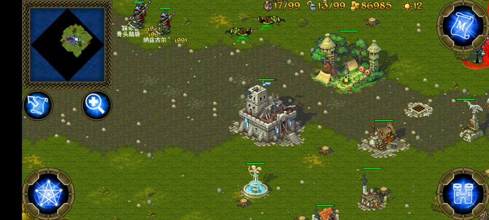
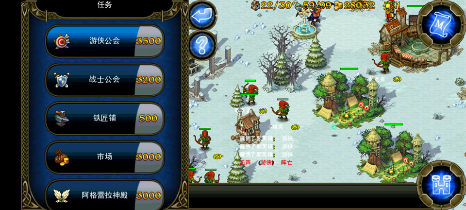

# 北方的扩张 · 中文显示补丁

给 Android 版 **Majesty: The Northern Expansion**（`com.herocraft.game.majesty_ne`，Marmalade / IwGx 引擎）做中文化的运行时补丁。

不改引擎的绘制代码，也不重做游戏的字体图集：在 `CIwGxFont::DrawText` 入口挂一个跳转，遇到码表里没有的码位就现场用 `stb_truetype` 光栅化，`glTexSubImage2D` 传进引擎自己的图集，再往码表/记录表里插一条。游戏自己就会把中文画出来。

## 效果

| 游戏内：英雄名、单位标签 | 事件提示与单位名 |
|---|---|
|  |  |
| 左侧「骨头骷髅」「纳兹古尔」是运行时生成的，原版图集里没有这些字形 | 左下角「雇佣了新英雄: 混沌战士」是引擎逐条推的事件消息 |

建造菜单：建筑名、造价、右侧事件流（「重创了新兵: 游侠」「无声（游侠）阵亡」）全部走同一套文本表：



同一份源码编译出两个版本：

| 功能 | 纯翻译版 | 完整版 |
|---|:---:|:---:|
| 中文显示（界面 / 单位 / 剧情 / 提示） | ✅ | ✅ |
| 百分网实名认证弹窗 | ❌ 已移除 | ❌ 已移除 |
| 一次点击升 50 级 | ❌ | ✅ |
| 钻石商店 14 项免费 | ❌ | ✅ |
| 英雄上限 20 → 99 | ❌ | ✅ |
| 单个建筑驻军上限 7 → 8 | ❌ | ✅ |
| 建筑数量上限绕过 | ❌ | ✅ |
| 关卡全解锁 | ❌ | ✅ |
| 老兵直升 99 级 | ❌ | ✅ |
| 阵营切换 / 金币宝箱 / 理想城堡 | ❌ | ✅ |
| 运行时命令通道（`settype` / `bld` / `savedump`…） | ❌ | ✅ |

两个版本都去掉了**百分网（byfen）实名认证**。原版启动 3 秒后会请求
`https://app2.byfen.com/get_country`，返回 `cn:true` **或者请求失败**都会弹「需完成实名认证后才能开始网络游戏」，
要求填中国大陆身份证号 —— 外国玩家访问这个接口经常超时，所以基本都会卡在这里。
补丁把 `com.authentication.MyApp.onCreate` 里注册认证回调的那几行去掉，链路就断了，游戏本体不动。
原理和验证方法见 [`docs/去认证说明.md`](docs/去认证说明.md)。

两版靠一个编译期宏 `ZF_CHEAT` 切分。**纯翻译版里连一个往游戏内存写数据的符号都不存在** —— 反汇编对比可以看到 `zh_cheat`、`zh_cmd2`、`zh_on_hero`、`zh_on_unit` 全部消失，只剩下 `zh_on_draw` 和字形光栅化那套。它等于「官方原版 + 汉化」。

## 下载

不想自己编译的话，打好的包在 [Releases](https://github.com/zgm1189/majesty-zh-patch/releases) 页面：

- `majesty_zh_lite.apk` —— 纯翻译版（已去实名认证）
- `majesty_zh_full.apk` —— 完整版（已去实名认证）

两个包名相同，只能装一个。首次安装需要先卸载官方版（签名不同），**卸载会清掉存档**。之后换版本可以直接覆盖，存档保留。

安装时用 `adb install --no-incremental`，或者直接用文件管理器点安装。走 `adb install -r` 而不带 `--no-incremental` 有概率触发 Incremental Install 把包卸掉重装，存档一起没 —— 这个坑踩过。

## 目录

```
src/
  zhfont.c          全部实现（约 4500 行，含完整注释与踩坑记录）
  cp_table.h        翻译里用到的码位表（自动生成）
  zhbtn.h           屏幕按钮（仅实验版使用）
  stb_truetype.h    单文件 TrueType 光栅化器
assets/
  zhfont_subset.ttf 字体子集（约 2000 字，2 MB）
  translate.dat     中文语言数据（替换 APK 里的 assets/translate.dat）
tools/
  build.sh          编译 + 打包 + 签名一条龙
  pack_apk.py       把 .so 塞进 APK（保持 resources.arsc 为 STORED）
analysis/           逆向过程脚本：DEX 解析、图集布局、码表导出、反汇编辅助
docs/               构建说明、版本说明、踩坑记录
方案_*.md           各功能的设计与验证记录（含错误结论的更正）
```

## 构建

需要 NDK（clang + llvm-readelf）、Android build-tools（zipalign + apksigner）、Python 3、JDK。

```bash
# 只编译两个 .so
bash tools/build.sh so

# 编译 + 打包 + 签名，两个 APK 一起出
bash tools/build.sh apk

# 只要纯翻译版 / 只要完整版
bash tools/build.sh apk lite
bash tools/build.sh apk full

# 去掉百分网实名认证（给没有大陆身份证的人用）
bash tools/build.sh apk both noauth
```

产物在 `build/out/`：`北方的扩张_纯翻译版.apk`、`北方的扩张_完整版.apk`。

打包需要一个**已注入加载器**的模板 APK（`libs3e_android.so` 的 `.init_array` 里多一项，负责 `dlopen("libzhfont.so")`）。这个模板不随仓库分发，原因见下面的免责声明；制作方法见 `docs/构建说明.md`。

## 几个绕不开的坑

- **镜像地址只能用运行时日志验证过的值。** 拿 objdump 反汇编引擎 bin 时，它把整个文件当 offset 0 的 `.text`，`adrp` 里的地址要减去 `0x4E01` 再按页对齐才是运行时偏移。我曾据此臆造出两组「别名槽」，写进去的是垃圾指针，游戏直接黑屏。
- **扫 ARM64 指令要从偏移 1 开始，步长 4。** 镜像里的文件偏移 ≡ 1 (mod 4)，用 `range(0, n, 4)` 扫会一条都命中不了。
- **比对指针前要摘掉 top-byte tag。** ARM64 的用户态指针带标签，`0x00FFFFFFFFFFFFFF` 之后再比。
- **`adb install -r` 会走 Incremental Install，把包卸掉重装，存档一起没。** 一定要加 `--no-incremental`。
- **改建筑类型必须同时写 `+0x40`（type）和 `+0x44`（sub）。** 只写 type，游戏会按 `(type, sub)` 查表越界，SIGSEGV。
- **正式版出包前检查 `.so` 里没有内部 UND 符号。** 内联汇编写死名字调用 C 函数时，编译器看不到引用会把它优化掉，留下一个 UND，`dlopen` 直接失败 —— 表现为「装上去了但什么都没发生」。

更多细节和事故复盘见 `docs/` 与根目录的 `方案_*.md`。

## 免责声明

本项目**仅供个人学习与逆向工程研究**，用于理解 Marmalade / IwGx 引擎的字体渲染管线与 ARM64 运行时 hook 技术。

- 游戏本体、字体、语言数据、美术资源的版权归 **HeroCraft** 所有，请购买正版支持开发者。
- 仓库**不分发**游戏原版 APK、修改后的完整 APK，或任何可用于绕过付费的内容。
- 因使用本补丁造成的存档损坏、账号异常或其他损失，作者不承担责任。
- 如果你是在寻找游戏，请到官方渠道获取；本补丁不提供游戏本体。

如有侵权，请联系删除。
